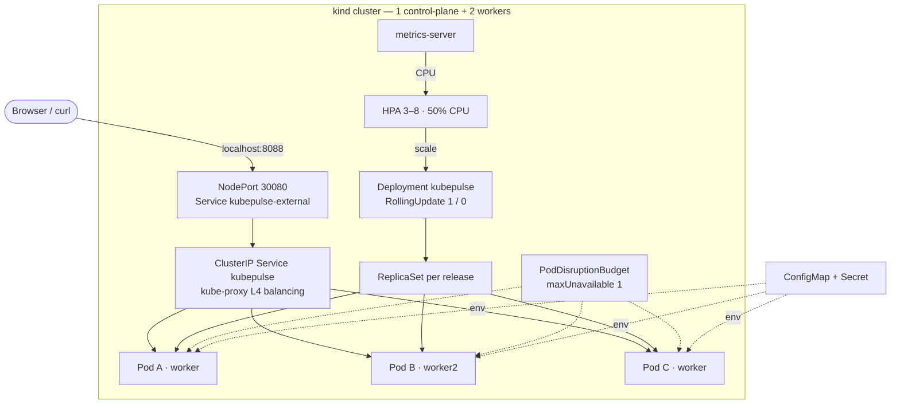

# KubePulse — Kubernetes Deployments, Services, Scaling & Rolling Updates
[](https://github.com/Achindra2003/devops-lab5-kubernetes-kubepulse)
[](https://github.com/Achindra2003/devops-lab5-kubernetes-kubepulse)
[](https://github.com/Achindra2003/devops-lab5-kubernetes-kubepulse)
[](https://github.com/Achindra2003/devops-lab5-kubernetes-kubepulse)
[](LICENSE)

> **DevOps Lab 5:** Deploy containerized applications on a Kubernetes cluster, configure Deployments, Services, scaling and rolling updates.  
> **Course:** MCA Trimester 5 — DevOps Lab  
> **Student:** Achindra Sharma (2547105) — 4MCA A  
> **Repository:** [https://github.com/Achindra2003/devops-lab5-kubernetes-kubepulse](https://github.com/Achindra2003/devops-lab5-kubernetes-kubepulse)  
> **Live dashboard:** [http://localhost:8088](http://localhost:8088) (after deployment)

---

## 1. What this is

Instead of deploying a static "hello world" Pod, this lab uses **KubePulse**, a small zero-dependency Node.js service that reports *which Pod served each request*. That makes Kubernetes behaviour visible and measurable:

| Lab requirement | What was built | Proof |
| :--- | :--- | :--- |
| Deploy containerized app | One hardened image, three releases (v1, v2, deliberately-broken v3) on a real **3-node kind cluster** | `npm run validate:deploy` |
| Configure Deployments | Probes, resources, ConfigMap/Secret, Downward API, topology spread, PDB, security context | `k8s/base/20-deployment.yaml` |
| Configure Services | `ClusterIP` (internal DNS) + `NodePort` (external → `localhost:8088`) | `validate:deploy`, `scripts/probe.js` |
| Scaling | Manual `kubectl scale` **and** CPU-driven **HPA** (3 → 8) with tuned scale-up/down behaviour | `npm run validate:scaling` |
| Rolling updates | Zero-downtime update under live traffic, a failing release stopped by the readiness gate, instant rollback | `npm run validate:rollout` |

### Beyond the baseline (self-learning)
Full write-up in [`docs/SELF_LEARNING.md`](docs/SELF_LEARNING.md). Highlights:
1. **Measured downtime**, not claimed: naive `Recreate` Deployment vs production manifest, same update, same traffic (`npm run compare:naive`).
2. **Failed-release protection:** a v3 image that never becomes Ready is stalled by `maxUnavailable: 0` while v2 keeps serving; `kubectl rollout undo` recovers.
3. **Chaos-proven probes:** readiness failure removes a Pod from Service endpoints *without* restarting it; a crash is restarted by the kubelet; a deleted Pod is replaced.
4. **HPA tuning** (and why `replicas:` is deliberately absent from the Deployment).
5. **Hardening:** non-root numeric UID, read-only root FS, all capabilities dropped, seccomp `RuntimeDefault`, secret never echoed by the API.
6. **A real finding:** kube-proxy balances per *TCP connection*, so keep-alive clients stick to one Pod — found while validating, fixed in the app, documented.
7. **CI:** unit tests → `kubeconform` schema check → real kind cluster end-to-end.

---

## 2. Architecture



## 3. Baseline vs production manifest

| Concern | Naive (`k8s/unoptimized/naive-deployment.yaml`) | Production (`k8s/base`) |
| :--- | :--- | :--- |
| Update strategy | `Recreate` — all Pods killed first | `RollingUpdate`, `maxSurge 1`, `maxUnavailable 0` |
| Traffic gating | none — Service routes on container start | readiness probe + `minReadySeconds: 5` |
| Hung process | never restarted | liveness + startup probes |
| Graceful stop | abrupt | `preStop sleep 5` + app drains on SIGTERM |
| Capacity | fixed replicas, no requests/limits | requests/limits, HPA 3–8 |
| Placement | scheduler default | topology spread across nodes, PDB |
| Security | defaults | non-root, read-only rootfs, drop ALL, seccomp |
| Config | baked in | ConfigMap, Secret, Downward API |
| **Failed requests during v1→v2** | **7 of 29 requests (measured)** | **0** |

---

## 4. Quick start (Windows / PowerShell, Docker Desktop running)

Prerequisites: Docker Desktop, `kubectl`, [`kind`](https://kind.sigs.k8s.io/) v0.27+, Node 22+.

```powershell
npm run cluster:create        # 3-node kind cluster, host :8088 -> NodePort 30080
npm run image:build           # kubepulse:1.0.0 / 2.0.0 / 3.0.0-broken
npm run image:load            # kind nodes cannot see local images until loaded
npm run metrics:install       # metrics-server (needed by the HPA)
npm run k8s:deploy            # kubectl apply -k k8s/base
npm run k8s:status
# open http://localhost:8088

npm test                      # app unit tests (no cluster needed)
npm run validate:deploy       # 9 checks: Deployment, Service, probes, security, balancing, config
npm run validate:resilience   # 4 checks: self-healing
npm run validate:rollout      # 5 checks: zero-downtime update, bad release, rollback
npm run validate:scaling      # 6 checks: manual scale + HPA out/in (~8 min)
npm run compare:naive         # measured downtime: naive vs production
```

`validate:rollout` expects the Deployment on v1 and leaves it on v2. To repeat: `kubectl delete -k k8s/base && kubectl apply -k k8s/base`.

**Using Docker Desktop's built-in Kubernetes instead of kind:** skip `cluster:create`/`image:load` (it shares the local image store) and set `KUBEPULSE_URL=http://localhost:30080`.

**Port note:** the cluster is published on **8088** to avoid clashing with other local services on 8080. Change `hostPort` in `k8s/kind-cluster.yaml` if you prefer.

## 5. Manual demos (for the viva)

```powershell
# Rolling update under the dashboard (watch "Failed requests" stay at 0)
kubectl -n kubepulse set image deploy/kubepulse app=kubepulse:2.0.0
kubectl -n kubepulse rollout status deploy/kubepulse

# Bad release, then recovery
kubectl -n kubepulse set image deploy/kubepulse app=kubepulse:3.0.0-broken
kubectl -n kubepulse get pods            # new Pod 0/1 forever, old Pods keep serving
kubectl -n kubepulse rollout undo deploy/kubepulse

# Scaling
kubectl -n kubepulse scale deploy/kubepulse --replicas=5
kubectl -n kubepulse get hpa -w          # then press "Start CPU load" on the dashboard

# Self-healing
kubectl -n kubepulse delete pod -l app=kubepulse --field-selector=status.phase=Running --wait=false
```

## 6. Repository layout

```
server.js, public/           app + live dashboard
Dockerfile                   one file, three releases via build args
k8s/kind-cluster.yaml        3-node cluster + host port mapping
k8s/base/                    namespace, config, deployment, services, hpa, pdb (kustomize)
k8s/unoptimized/             naive baseline used for the measured comparison
scripts/validate-*.js        4 validation suites     scripts/compare-naive.js  baseline experiment
scripts/capture-evidence.py  runs real commands, renders output to PNG
tests/app.test.js            unit tests              .github/workflows/k8s-ci.yml  CI
docs/                        LAB_5_REPORT.md, SELF_LEARNING.md, EVALUATION_CHEAT_SHEET.md, screenshots/, evidence/
```

## 7. Cleanup

```powershell
npm run k8s:teardown     # remove the app
npm run cluster:delete   # remove the whole kind cluster
```
