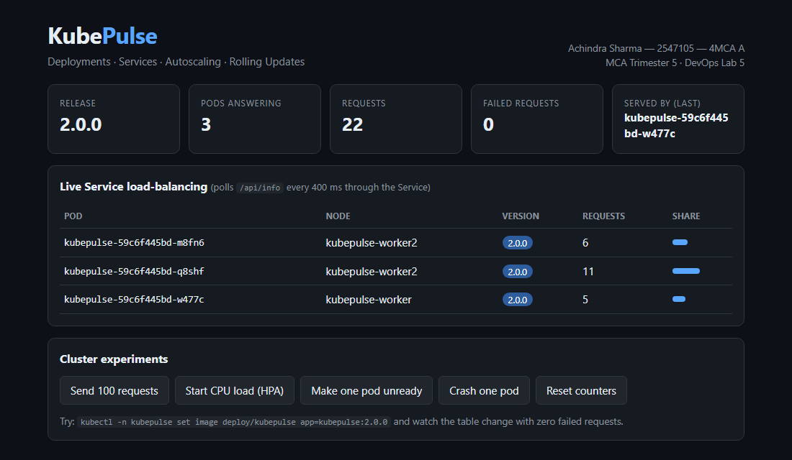
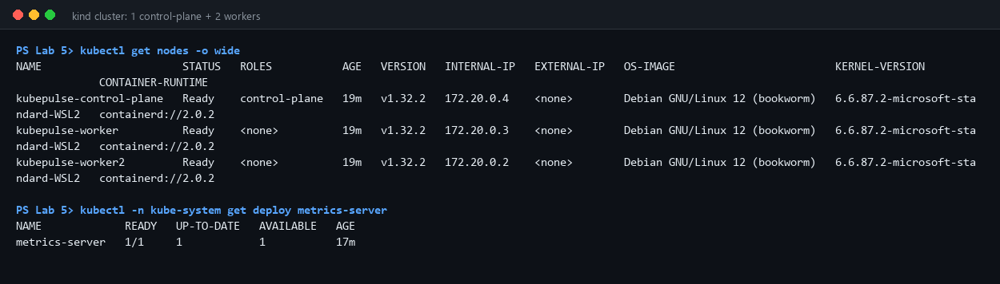
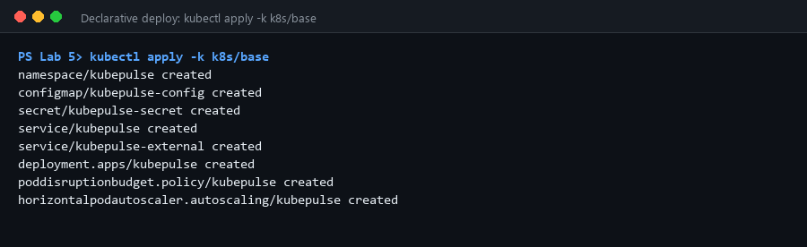
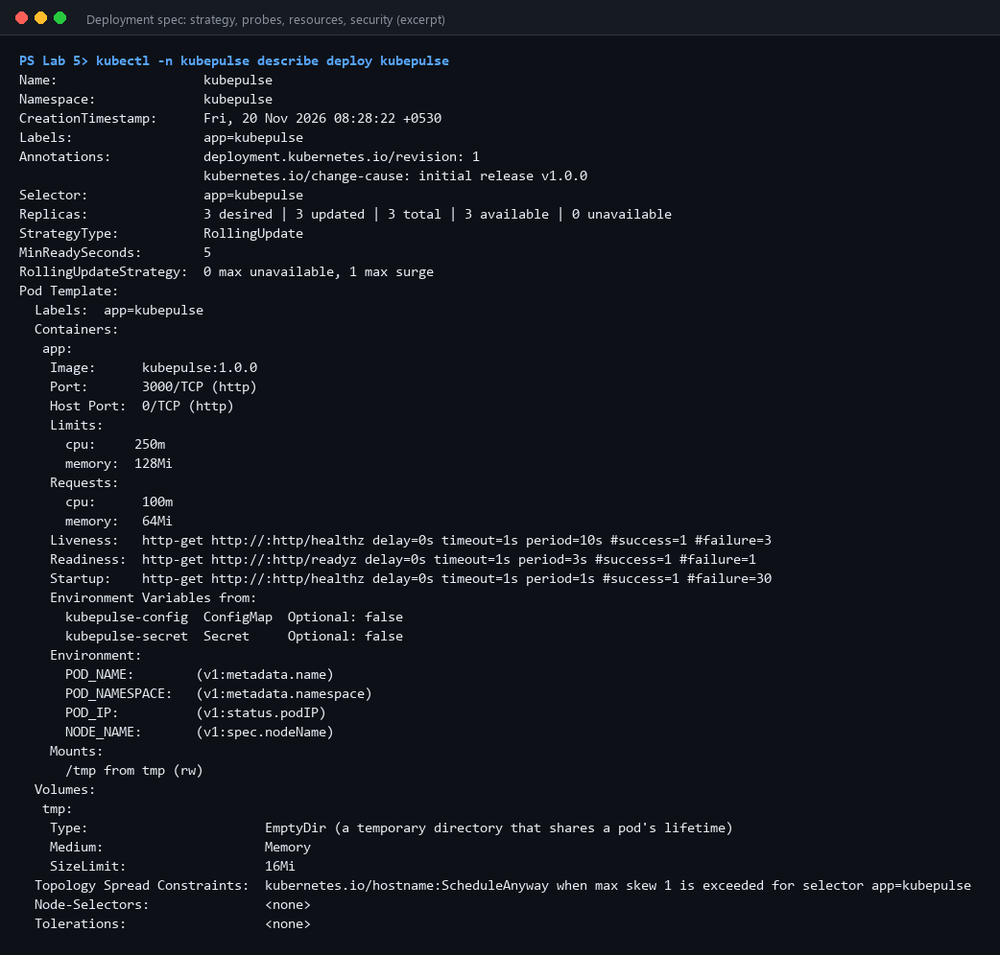
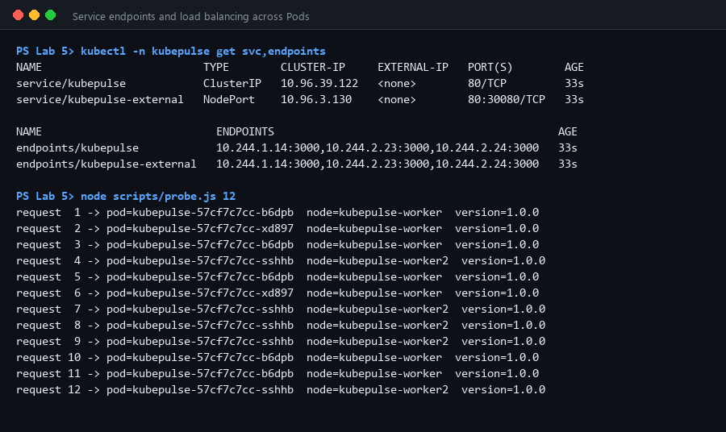
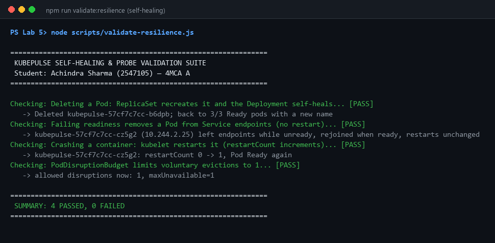

# Lab 5 Report: Deploying a Containerized Application on Kubernetes — Deployments, Services, Scaling & Rolling Updates

**Course:** MCA Trimester 5 — DevOps Lab (Lab 5)  
**Submission Type:** Individual Lab Submission  
**Student Name:** Achindra Sharma  
**Register Number:** 2547105  
**Class / Section:** 4MCA A  
**Application:** KubePulse — Kubernetes-aware microservice with a live dashboard  
**Cluster:** kind v0.27.0, Kubernetes v1.32.2, 3 nodes (1 control-plane, 2 workers)  
**Dashboard URL:** `http://localhost:8088`  
**GitHub Repository:** _add link after pushing_

All figures below are real command output captured by `scripts/capture-evidence.py`; the raw text for each is in `docs/evidence/`.

---

## 1. Project Background

A minimal Kubernetes lab runs `kubectl create deployment`, exposes it, scales it and changes the image once. That shows the commands but not the engineering questions: *is an update safe, what happens when a release is bad, how does the cluster react to load and failure?* This lab answers each with a measurement.

**KubePulse** is a zero-dependency Node.js service that reports the Pod, node and version that served each request, exposes readiness/liveness endpoints, can burn CPU on demand (for the autoscaler) and has lab-only chaos endpoints (unready, crash). One Dockerfile produces three releases: `1.0.0`, `2.0.0`, and `3.0.0-broken` (alive but never Ready).

  
*Figure 1: Live dashboard through the Service. Three Pods on two workers, release 2.0.0, 0 failed requests.*

---

## 2. Cluster and Deployment

A 3-node kind cluster (`k8s/kind-cluster.yaml`) gives real scheduling and node spread. The NodePort is published on host port 8088 (8080 was already in use on the host).

  
*Figure 2: Three Ready nodes, Kubernetes v1.32.2; metrics-server installed.*

  
*Figure 3: Three release images from one Dockerfile (build args `APP_VERSION`, `BROKEN`).*

The application is deployed declaratively with kustomize (`kubectl apply -k k8s/base`): Namespace, ConfigMap, Secret, Deployment, two Services, HorizontalPodAutoscaler and PodDisruptionBudget.

  
*Figure 4: Declarative deployment.*

  
*Figure 5: Deployment 3/3, Pods spread over `kubepulse-worker` and `kubepulse-worker2`, ClusterIP and NodePort Services, HPA 3–8, PDB. (`cpu: <unknown>` in this early capture is metrics-server's first scrape; see Figure 10 for live values.)*

### Key Deployment settings (`k8s/base/20-deployment.yaml`)

| Setting | Value | Reason |
| :--- | :--- | :--- |
| Strategy | `RollingUpdate`, `maxSurge: 1`, `maxUnavailable: 0` | New Pod Ready before an old one is removed |
| `minReadySeconds` / `progressDeadlineSeconds` | 5 / 60 | Avoid counting flapping Pods; flag stalled rollouts |
| Probes | startup, readiness (`/readyz`), liveness (`/healthz`) | Traffic gating vs restart semantics |
| `preStop` | `sleep 5` | Let endpoint removal propagate before SIGTERM |
| Resources | request 100m/64Mi, limit 250m/128Mi | HPA utilisation is relative to the CPU request |
| Placement | topology spread on hostname, PDB `maxUnavailable: 1` | Survive node loss/drains |
| Security | non-root UID 1000, read-only rootfs, drop ALL, seccomp RuntimeDefault | Least privilege |
| Config | ConfigMap + Secret via `envFrom`; Downward API for Pod/node name | Config outside the image |
| `replicas` | omitted | HPA owns the count; `apply` must not reset it |

  
*Figure 6: `kubectl describe deployment` excerpt: strategy `0 max unavailable, 1 max surge`, probes, resources.*

---

## 3. Services

`kubepulse` (ClusterIP, DNS `kubepulse.kubepulse.svc.cluster.local`) is used inside the cluster; `kubepulse-external` (NodePort 30080) is reachable from the host on `localhost:8088`.

  
*Figure 7: Endpoints list the three Pod IPs; twelve consecutive requests are answered by different Pods on both workers.*

**Finding:** the first version of the validation showed all requests going to a single Pod. `kube-proxy` balances per TCP *connection*, and an HTTP keep-alive client reuses one connection. The API now answers with `Connection: close`, so each request is balanced. For gRPC/long-lived clients, client-side balancing or a mesh is needed.

  
*Figure 8: `validate:deploy` — 9/9 checks pass (availability, strategy, node spread, probes, hardening, endpoints, in-cluster DNS, NodePort balancing, config injection).*

---

## 4. Self-Healing and Probes

`validate:resilience` (4/4 pass) exercises each probe's semantics on a live Pod:

| Action | Result observed |
| :--- | :--- |
| Delete a Pod | ReplicaSet created a replacement; back to 3/3 Ready |
| Force readiness to fail | Pod IP left Service endpoints, **restart count unchanged**, rejoined when ready |
| Crash the container | kubelet restarted it: `restartCount 0 -> 1`, Pod Ready again |
| PDB | `maxUnavailable: 1`, 1 disruption allowed |

  
*Figure 9: Self-healing suite output.*

---

## 5. Rolling Updates, Failed Release, Rollback

`validate:rollout` (5/5 pass) runs under continuous traffic (a request every ~40 ms through the NodePort):

| Step | Result |
| :--- | :--- |
| v1 → v2 rolling update | **675 requests, 0 failed**; served 395 × v1.0.0 and 280 × v2.0.0 (both versions live during the roll) |
| v3 (never Ready) | Rollout **stalled** (`available=3, unavailable=1`); **796 requests, 0 failed, all served by v2.0.0**; none reached v3 |
| `kubectl rollout undo` | v2 restored under traffic, 0 failed requests |
| `kubectl rollout history` | Revisions with `kubernetes.io/change-cause` |

  
*Figure 10: Zero-downtime update, contained bad release, rollback.*

### Measured baseline: naive vs production

`compare:naive` repeats the same v1 → v2 update with `k8s/unoptimized/naive-deployment.yaml` (`Recreate`, no probes) and with the production manifest, under the same traffic:

| Manifest | Requests during update | Failed |
| :--- | :---: | :---: |
| Naive (`Recreate`, no probes) | 29 | **7** (connection failures and timeouts) |
| Production (`RollingUpdate 1/0`, readiness, preStop) | 910 | **0** |

The naive run also issued far fewer requests because each failed request waits for its timeout while the Deployment has no Pods.

  
*Figure 11: Measured downtime of the baseline against the production manifest.*

---

## 6. Scaling

`validate:scaling` (6/6 pass):

| Step | Result |
| :--- | :--- |
| metrics-server | `kubectl top pods` returns Pod CPU/memory |
| HPA live utilisation | `cpu: 9%/50%`, 3 replicas when idle |
| Manual `kubectl scale --replicas=5` | 5 Ready replicas |
| HPA override | HPA scaled 5 → 3 (min) once idle (60 s window, −1 Pod / 30 s) |
| CPU load via `/api/load` | HPA scaled out 3 → 4+ with CPU samples above 200 % of the request (230 % at last sample) |
| Load removed | HPA scaled in (6 → 5 observed, −1 Pod / 30 s) |

  
*Figure 12: Manual scaling and HPA scale-out/scale-in. The trailing `kubectl get hpa` shows the autoscaler still stepping down.*

---

## 7. Beyond the Baseline — Eight Self-Learning Initiatives

Details in [`SELF_LEARNING.md`](SELF_LEARNING.md).

1. **Measured rolling update vs naive baseline** (0 vs 7 failed requests).
2. **Failed-release protection and rollback** with revision history.
3. **Three-probe health model proven by chaos tests.**
4. **HPA with tuned behaviour**; `replicas` omitted so apply does not fight the autoscaler.
5. **Topology spread + PodDisruptionBudget.**
6. **Pod hardening** (numeric non-root UID, read-only rootfs, drop ALL, seccomp).
7. **ConfigMap / Secret / Downward API.**
8. **Automation:** four validation suites (24 checks), baseline experiment, and CI (unit tests → `kubeconform` → kind end-to-end).

## 8. Problems Encountered

| Problem | Cause | Resolution |
| :--- | :--- | :--- |
| All requests hit one Pod | kube-proxy balances per TCP connection | `Connection: close` in the API |
| Rollout test reported only ~50 requests | Synchronous `kubectl` call froze Node's event loop and the traffic generator | Async child process for long calls |
| `kind create cluster` failed: `port is already allocated` | Another container already bound host port 8080 | Cluster publishes on 8088 |
| Naive baseline got no traffic | Service `targetPort: http` is a *named* port; the Pod's port was unnamed → zero endpoints | Named the port in the baseline so only strategy/probes differ |
| Wrong revision labels in rollout history | Annotating after `set image` races the controller | One atomic `kubectl patch`; annotate after `undo` |

## 9. Key Learnings

1. Zero downtime is a property of strategy **and** probes **and** shutdown behaviour together; removing any one drops requests.
2. Readiness controls traffic, liveness controls restarts — they must not be conflated.
3. Services balance connections, not requests.
4. The HPA and a fixed `replicas:` field conflict; pick one owner.
5. A validation that can silently measure nothing is worse than none — verify the measurement ran.

## 10. Limitations

- kind is a local cluster: no cloud LoadBalancer, and `--kubelet-insecure-tls` is used for metrics-server (lab only).
- The default kind CNI does not enforce NetworkPolicy, so none is claimed.
- The Secret is a demo value in a manifest; real deployments need an external secret store.
- The HPA suite takes about 8 minutes and is run locally, not in CI.
