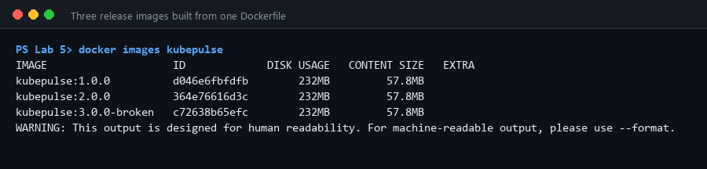
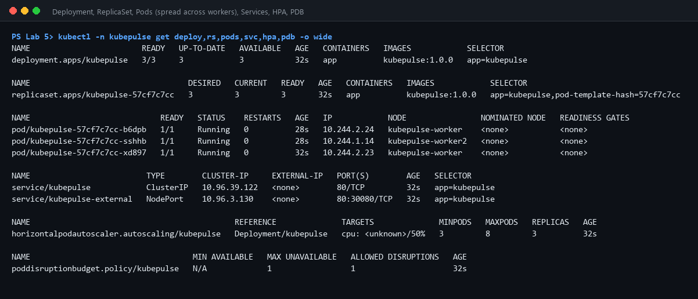
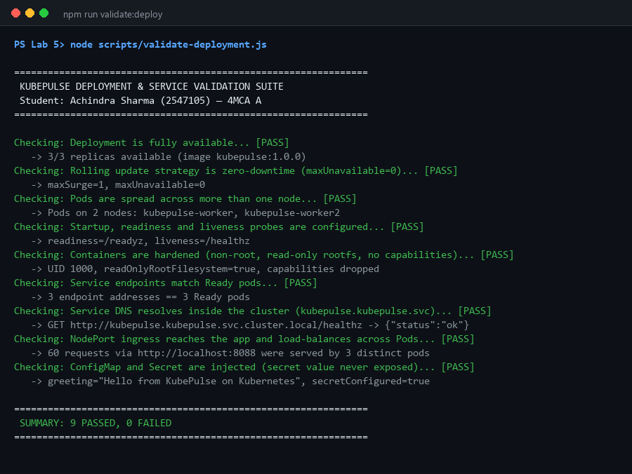
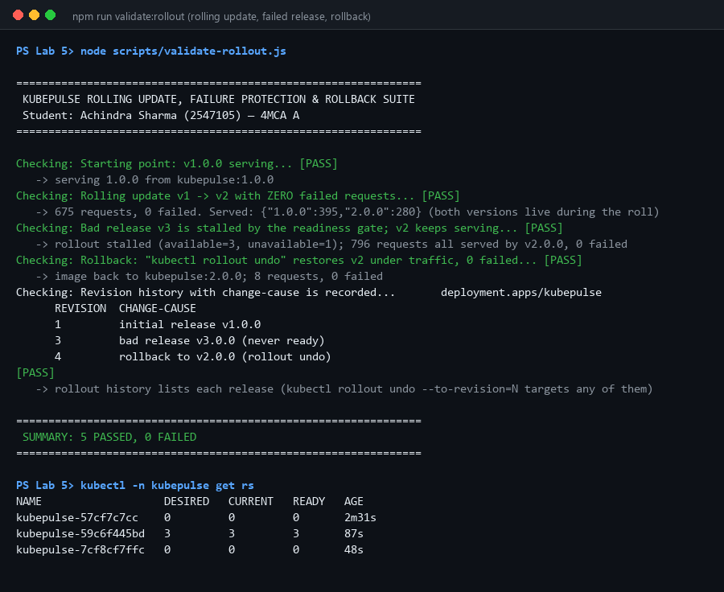
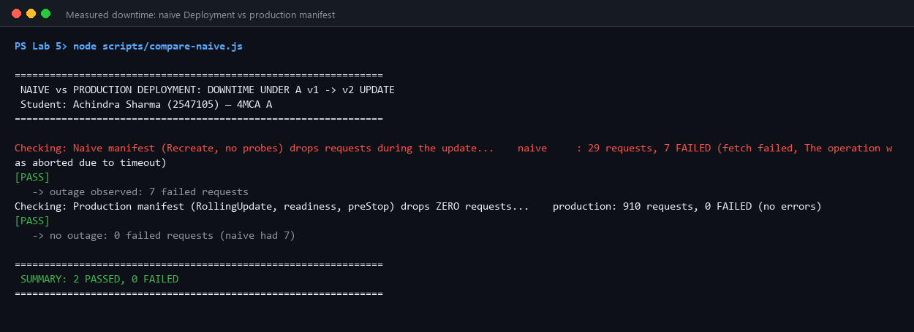
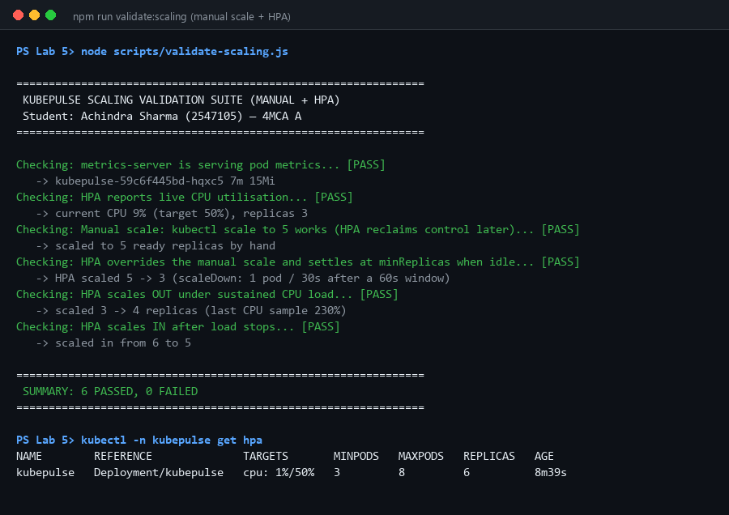

# Lab 5 Report: Kubernetes Deployments, Services, Autoscaling & Zero-Downtime Rolling Updates

**Course:** MCA Trimester 5 — DevOps Lab (Lab 5)  
**Submission Type:** Individual Lab Submission  
**Student Name:** Achindra Sharma  
**Register Number:** 2547105  
**Class / Section:** 4MCA A  
**Application:** KubePulse — Kubernetes-Aware Microservice with Probe-Gated Rollouts, HPA Autoscaling & Chaos-Verified Self-Healing  
**GitHub Repository:** [https://github.com/Achindra2003/devops-lab5-kubernetes-kubepulse](https://github.com/Achindra2003/devops-lab5-kubernetes-kubepulse)  
**Cluster Launch Command:** `npm run cluster:create` then `npm run k8s:deploy`  
**Ingress Portal URL:** `http://localhost:8088`

> **Evidence policy.** Every figure in this report is real command output captured from the running cluster by `scripts/capture-evidence.py`. The raw text behind each figure is stored in `docs/evidence/NN-*.txt`. No output was typed or edited by hand.

---

## 1. Project Background & System Context

### The Challenge with Naive Kubernetes Deployments
The usual first Kubernetes exercise is `kubectl create deployment`, `kubectl expose` and one `kubectl scale`. The commands work, but the manifest that results has serious operational weaknesses:

1. **Update Outages:** The `Recreate` strategy (or an unprobed rolling update) removes capacity before replacements are ready. Users see connection errors on every release.
2. **Traffic to Unready Pods:** Without a readiness probe, a Service routes requests to a container the moment it starts, before the application can answer.
3. **Bad Releases Take Capacity Away:** Without a progress deadline and `maxUnavailable: 0`, a broken image replaces healthy Pods, turning a deploy into an incident.
4. **Static Capacity:** A fixed replica count wastes resources when idle and saturates under load; without CPU requests the autoscaler cannot work at all.
5. **Unhardened Containers:** Default security context leaves a writable root filesystem, default Linux capabilities and no seccomp profile.

### What We Built: KubePulse
To demonstrate and *measure* the fixes, we built **KubePulse**, a zero-dependency Node.js microservice that reports the Pod, node and release that served each request, together with a Kubernetes platform around it:
- **Application:** `/api/info` (Pod identity via the Downward API), `/readyz` and `/healthz` probes, `/api/load` (on-demand CPU burn for the autoscaler), lab-only `/api/chaos/*` endpoints, graceful `SIGTERM` draining.
- **Three releases from one Dockerfile:** `1.0.0`, `2.0.0` and `3.0.0-broken` (alive but never Ready).
- **Cluster:** a real 3-node kind cluster (1 control-plane, 2 workers).
- **Workload objects:** Namespace, ConfigMap, Secret, Deployment, ClusterIP + NodePort Services, HorizontalPodAutoscaler, PodDisruptionBudget — applied with kustomize.
- **Automation:** four validation suites (24 checks), a measured naive-vs-production experiment and a CI pipeline.

### Experimental Environment

| Component | Version / Detail |
| :--- | :--- |
| Host OS | Windows 11, Docker Desktop (engine 29.1.3, WSL2 backend) |
| Cluster | kind v0.27.0 — Kubernetes v1.32.2, containerd 2.0.2 |
| Nodes | `kubepulse-control-plane`, `kubepulse-worker`, `kubepulse-worker2` |
| Client tools | kubectl v1.34.1 (Kustomize v5.7.1), Node.js v22.17.0 |
| Image base | `node:22-alpine` (57.8 MB content, 232 MB on disk) |
| metrics-server | v0.7.2, patched with `--kubelet-insecure-tls` (lab only) |

---

> ### 📸 Screenshot 1 Instruction: Interactive KubePulse Live Dashboard
> * **What to capture:** Browser showing the dashboard at `http://localhost:8088`.
> * **How to take it:** With the cluster running, open the URL, click **Send 100 requests**, and press `Win + Shift + S`.
> * **What evaluators check:** URL on port 8088, student attribution (`Achindra Sharma — 2547105 — 4MCA A`), the Release card, the per-Pod table showing different Pods and nodes, and **Failed requests: 0**.
> * **File destination:** `docs/screenshots/12-kubepulse-dashboard.png`.

  
*Figure 1: Dashboard served through the Kubernetes Service. Three Pods across two worker nodes, release 2.0.0, 0 failed requests.*

---

## 2. Cluster Provisioning & Image Release Pipeline

A single-node cluster cannot demonstrate scheduling, node spread or node-level failure, so the lab uses a 3-node cluster defined in `k8s/kind-cluster.yaml`. A host port mapping publishes NodePort `30080` as `localhost:8088`.

```yaml
kind: Cluster
apiVersion: kind.x-k8s.io/v1alpha4
nodes:
  - role: control-plane
    extraPortMappings:
      - { containerPort: 30080, hostPort: 8088, protocol: TCP }
  - role: worker
  - role: worker
```

The same `Dockerfile` produces all three releases through build arguments, so v1, v2 and the broken v3 differ only by configuration:
```bash
docker build --build-arg APP_VERSION=1.0.0 -t kubepulse:1.0.0 .
docker build --build-arg APP_VERSION=2.0.0 -t kubepulse:2.0.0 .
docker build --build-arg APP_VERSION=3.0.0 --build-arg BROKEN=true -t kubepulse:3.0.0-broken .
kind load docker-image kubepulse:1.0.0 kubepulse:2.0.0 kubepulse:3.0.0-broken --name kubepulse
```
`kind load` is required because kind nodes are containers with their own image store and cannot see the host's images; the Deployment therefore uses `imagePullPolicy: IfNotPresent`.

---

> ### 📸 Screenshot 2 Instruction: Three-Node Cluster
> * **What to capture:** Terminal output of `kubectl get nodes -o wide`.
> * **How to take it:** After `npm run cluster:create`, run the command and capture with `Win + Shift + S`.
> * **What evaluators check:** Three nodes `Ready` (one `control-plane`, two workers) and version `v1.32.2`.
> * **File destination:** `docs/screenshots/01-cluster-nodes.png`.

  
*Figure 2: Three-node cluster, Kubernetes v1.32.2. metrics-server is installed for the autoscaler.*

---

> ### 📸 Screenshot 3 Instruction: Release Images
> * **What to capture:** Terminal output of `docker images kubepulse`.
> * **How to take it:** After `npm run image:build`, run the command.
> * **What evaluators check:** Three tags (`1.0.0`, `2.0.0`, `3.0.0-broken`) built from one Dockerfile.
> * **File destination:** `docs/screenshots/02-docker-images.png`.

  
*Figure 3: Three release images built from a single parameterised Dockerfile.*

---

## 3. Deployment Architecture

### The Baseline Anti-Pattern (`k8s/unoptimized/naive-deployment.yaml`)
To give empirical proof of the improvement, we authored the manifest that most first attempts produce:
```yaml
apiVersion: apps/v1
kind: Deployment
metadata: { name: kubepulse, namespace: kubepulse }
spec:
  replicas: 3
  strategy: { type: Recreate }
  selector: { matchLabels: { app: kubepulse } }
  template:
    metadata: { labels: { app: kubepulse } }
    spec:
      containers:
        - name: app
          image: kubepulse:1.0.0
          ports: [{ name: http, containerPort: 3000 }]
```
#### Flaws in this baseline
1. **`Recreate` strategy:** every Pod is killed before a replacement starts — a guaranteed outage on each release.
2. **No readiness probe:** the Service routes traffic the moment the container starts.
3. **No liveness/startup probes:** a hung process is never restarted.
4. **No resource requests:** the scheduler is blind and the HPA cannot compute utilisation.
5. **No security context, no graceful stop, config baked into the image.**

### The Production Deployment (`k8s/base/20-deployment.yaml`)
```yaml
spec:
  # replicas omitted on purpose: the HPA owns the count
  revisionHistoryLimit: 5
  minReadySeconds: 5
  progressDeadlineSeconds: 60
  strategy:
    type: RollingUpdate
    rollingUpdate: { maxSurge: 1, maxUnavailable: 0 }
  template:
    spec:
      terminationGracePeriodSeconds: 30
      securityContext:
        { runAsNonRoot: true, runAsUser: 1000, runAsGroup: 1000, seccompProfile: { type: RuntimeDefault } }
      topologySpreadConstraints:
        - { maxSkew: 1, topologyKey: kubernetes.io/hostname, whenUnsatisfiable: ScheduleAnyway,
            labelSelector: { matchLabels: { app: kubepulse } } }
      containers:
        - name: app
          image: kubepulse:1.0.0
          envFrom: [{ configMapRef: { name: kubepulse-config } }, { secretRef: { name: kubepulse-secret } }]
          env: # Downward API: Pod name, namespace, IP, node
          resources: { requests: { cpu: 100m, memory: 64Mi }, limits: { cpu: 250m, memory: 128Mi } }
          securityContext: { allowPrivilegeEscalation: false, readOnlyRootFilesystem: true, capabilities: { drop: ["ALL"] } }
          startupProbe:   { httpGet: { path: /healthz, port: http }, periodSeconds: 1, failureThreshold: 30 }
          readinessProbe: { httpGet: { path: /readyz,  port: http }, periodSeconds: 3, failureThreshold: 1 }
          livenessProbe:  { httpGet: { path: /healthz, port: http }, periodSeconds: 10, failureThreshold: 3 }
          lifecycle: { preStop: { exec: { command: ["sleep", "5"] } } }
```

### Production vs Baseline

| Concern | Baseline | Production | Why it matters |
| :--- | :--- | :--- | :--- |
| Update strategy | `Recreate` | `RollingUpdate`, surge 1, unavailable 0 | New Pod Ready before an old one is removed |
| Traffic gating | none | readiness probe + `minReadySeconds` | Only working Pods receive requests |
| Hung process | never restarted | liveness + startup probes | Self-recovery without loosening liveness |
| Graceful stop | abrupt | `preStop sleep` + app drains on SIGTERM | Endpoint removal propagates first |
| Capacity | fixed | requests/limits + HPA 3–8 | Elastic; HPA needs requests |
| Placement | default | topology spread + PDB | Node loss/drain stays within budget |
| Security | defaults | non-root, read-only rootfs, drop ALL, seccomp | Least privilege |
| Configuration | baked in | ConfigMap, Secret, Downward API | Config separate from image |

---

> ### 📸 Screenshot 4 Instruction: Declarative Deployment
> * **What to capture:** Terminal output of `kubectl apply -k k8s/base`.
> * **How to take it:** Run the command on a clean namespace and capture the object-creation lines.
> * **What evaluators check:** Namespace, ConfigMap, Secret, two Services, Deployment, PodDisruptionBudget and HorizontalPodAutoscaler all created.
> * **File destination:** `docs/screenshots/03-kubectl-apply.png`.

  
*Figure 4: One declarative command creates all objects.*

---

> ### 📸 Screenshot 5 Instruction: Workload Overview
> * **What to capture:** `kubectl -n kubepulse get deploy,rs,pods,svc,hpa,pdb -o wide`.
> * **How to take it:** Run once all Pods are Running.
> * **What evaluators check:** 3/3 Pods on two different worker nodes, ClusterIP and NodePort `80:30080/TCP` Services, HPA 3–8, PDB with 1 allowed disruption.
> * **File destination:** `docs/screenshots/04-get-all.png`.

  
*Figure 5: Deployment, ReplicaSet, Pods spread across `kubepulse-worker` and `kubepulse-worker2`, both Services, HPA and PDB. (`cpu: <unknown>` is metrics-server's first scrape; live values appear in Figure 12.)*

---

> ### 📸 Screenshot 6 Instruction: Deployment Specification
> * **What to capture:** `kubectl -n kubepulse describe deploy kubepulse` (top of output).
> * **What evaluators check:** `RollingUpdateStrategy: 0 max unavailable, 1 max surge`, `MinReadySeconds: 5`, the three probes, requests/limits, ConfigMap and Secret environment sources.
> * **File destination:** `docs/screenshots/05-describe-deployment.png`.

  
*Figure 6: The cluster confirms the strategy, probes and resource settings from the manifest.*

---

## 4. Service Architecture & Load Balancing Validation

```
  [ Browser / curl ]
         |  http://localhost:8088
         v
  +-------------------------------------------------------+
  | kind node: NodePort 30080                             |
  | Service kubepulse-external (NodePort)                 |
  +---------------------------+---------------------------+
                              | kube-proxy (L4, per TCP connection)
                              v
  Service kubepulse (ClusterIP :80 -> targetPort "http")
  DNS: kubepulse.kubepulse.svc.cluster.local
          |                 |                 |
          v                 v                 v
    Pod A (worker)   Pod B (worker2)   Pod C (worker)   <- HPA scales 3..8
          ^                 ^                 ^
          +-----------------+-----------------+
          Deployment -> ReplicaSet (one per release)
          PodDisruptionBudget: maxUnavailable 1
```

- **ClusterIP `kubepulse`:** stable virtual IP and DNS name for in-cluster clients; Pods are selected by label `app=kubepulse`.
- **NodePort `kubepulse-external`:** opens port `30080` on every node, published to the host as `8088`.
- Both Services use a **named** `targetPort: http`, so Pod port numbers can change without touching the Service.

### Finding: Services balance connections, not requests
The first validation run sent 60 sequential requests through the NodePort and **all 60 reached one Pod**. `kube-proxy` is a Layer-4 balancer: it chooses a backend per TCP connection, and an HTTP keep-alive client reuses one connection. The API now replies `Connection: close`, so every request is re-balanced (and re-resolved during rollouts). Long-lived or gRPC clients need client-side balancing, a headless Service or a service mesh.

---

> ### 📸 Screenshot 7 Instruction: Endpoints & Balancing
> * **What to capture:** `kubectl -n kubepulse get svc,endpoints` followed by `node scripts/probe.js 12`.
> * **What evaluators check:** Endpoints list three Pod IPs; twelve consecutive requests are answered by different Pods on both workers.
> * **File destination:** `docs/screenshots/06-service-load-balancing.png`.

  
*Figure 7: Requests through the Service are distributed across three Pods on two nodes.*

---

## 5. Automated Validation Suites

Each suite is a Node.js script that queries the live cluster and exits non-zero on failure (used unchanged by CI).

| Suite | Command | Checks | Result |
| :--- | :--- | :---: | :---: |
| Deployment & Service | `npm run validate:deploy` | 9 | 9 PASS |
| Self-healing | `npm run validate:resilience` | 4 | 4 PASS |
| Rolling update | `npm run validate:rollout` | 5 | 5 PASS |
| Scaling | `npm run validate:scaling` | 6 | 6 PASS |
| Baseline experiment | `npm run compare:naive` | 2 | 2 PASS |

### 5.1 Deployment & Service (`validate:deploy`)
Verifies: availability (3/3), `maxUnavailable=0`, Pods on more than one node, all three probes present, hardening (non-root UID 1000, read-only rootfs, privilege escalation off), Service endpoints equal Ready Pods, in-cluster DNS resolution, NodePort load balancing across ≥2 Pods, and ConfigMap/Secret injection with the secret value never exposed.

> ### 📸 Screenshot 8 Instruction: Deployment Suite
> * **What to capture:** `node scripts/validate-deployment.js`.
> * **What evaluators check:** `9 PASSED, 0 FAILED`.
> * **File destination:** `docs/screenshots/07-validate-deployment.png`.

  
*Figure 8: `validate:deploy` — 9 PASSED, 0 FAILED.*

### 5.2 Self-Healing & Probe Semantics (`validate:resilience`)

| Action on a live Pod | Observed behaviour |
| :--- | :--- |
| Delete a Pod | ReplicaSet created a replacement; Deployment back to 3/3 Ready |
| Force readiness to fail | Pod IP left the Service endpoints; **`restartCount` unchanged**; rejoined when ready |
| Crash the container | kubelet restarted it: `restartCount 0 → 1`, Pod Ready again |
| PodDisruptionBudget | `maxUnavailable: 1`, 1 disruption allowed |

This demonstrates the key distinction: **readiness controls traffic, liveness controls restarts.**

> ### 📸 Screenshot 9 Instruction: Self-Healing Suite
> * **What to capture:** `node scripts/validate-resilience.js`.
> * **What evaluators check:** `4 PASSED, 0 FAILED`; the readiness check states restarts unchanged; the crash check shows `restartCount 0 -> 1`.
> * **File destination:** `docs/screenshots/08-validate-resilience.png`.

  
*Figure 9: Pod replacement, readiness gating without restart, crash restart.*

---

## 6. Rolling Updates, Failed Release & Rollback

### Methodology
A background traffic generator sends one request every 40 ms (25 ms in the naive-vs-production experiment), plus request time, to `http://localhost:8088/api/info` using independent connections, with a 3-second timeout, while the release changes. A request counts as *failed* on any network error, timeout or non-2xx status. Versions seen are tallied from the response body. All operations are performed with real `kubectl` commands.

### Results (`validate:rollout`)

| Step | Requests | Failed | Observation |
| :--- | :---: | :---: | :--- |
| v1 → v2 rolling update | 675 | **0** | 395 served by v1.0.0 and 280 by v2.0.0 — both versions live during the roll |
| Bad release `3.0.0-broken` | 796 | **0** | Rollout **stalled** (`available=3, unavailable=1`); every request served by v2.0.0; none reached v3 |
| `kubectl rollout undo` | 8 | **0** | v2 restored under traffic |
| `kubectl rollout history` | — | — | Revisions listed with `kubernetes.io/change-cause` |

Why the bad release is harmless: `maxUnavailable: 0` forbids removing an old Pod until its replacement is Ready, the broken Pod never passes `/readyz`, so capacity never drops; `progressDeadlineSeconds: 60` marks the rollout failed.

> ### 📸 Screenshot 10 Instruction: Rolling Update Suite
> * **What to capture:** `node scripts/validate-rollout.js`, then `kubectl -n kubepulse get rs`.
> * **What evaluators check:** `5 PASSED, 0 FAILED`; `0 failed` in the update, stalled-release and rollback lines.
> * **File destination:** `docs/screenshots/09-validate-rollout.png`.

  
*Figure 10: Zero-downtime update, contained bad release, instant rollback.*

### Measured Baseline: Naive vs Production
The identical v1 → v2 update was run against both manifests under the same traffic (`npm run compare:naive`):

| Manifest | Requests during update | Failed requests |
| :--- | :---: | :---: |
| Naive (`Recreate`, no probes) | 29 | **7** (connection failures, timeouts) |
| Production (`RollingUpdate 1/0`, readiness, preStop) | 910 | **0** |

The naive run completed far fewer requests because each failed request waits for its timeout while the Deployment has no Pods.

> ### 📸 Screenshot 11 Instruction: Naive vs Production
> * **What to capture:** `node scripts/compare-naive.js`.
> * **What evaluators check:** Naive line reports FAILED requests; production line reports `0 FAILED`.
> * **File destination:** `docs/screenshots/11-naive-vs-production.png`.

  
*Figure 11: Measured downtime — naive manifest vs production manifest.*

---

## 7. Scaling: Manual and Horizontal Pod Autoscaler

The HPA (`autoscaling/v2`) targets 50 % of the **CPU request** (100 m), between 3 and 8 replicas:
```yaml
behavior:
  scaleUp:   { stabilizationWindowSeconds: 0,  policies: [{ type: Pods, value: 2, periodSeconds: 15 }] }
  scaleDown: { stabilizationWindowSeconds: 60, policies: [{ type: Pods, value: 1, periodSeconds: 30 }] }
```
The default scale-down window is 300 s; it was shortened to 60 s so scale-in can be observed in a lab session.

### Results (`validate:scaling`)

| Step | Observation |
| :--- | :--- |
| metrics-server | `kubectl top pods` returns CPU/memory per Pod |
| Idle utilisation | `cpu: 9%/50%`, 3 replicas |
| `kubectl scale --replicas=5` | 5 Ready replicas |
| HPA reclaims control | scaled 5 → 3 once idle (the manifest omits `replicas` so `apply` cannot fight the HPA) |
| CPU load through `/api/load` | scaled out 3 → 4+ replicas; last CPU sample **230 %** of the request |
| Load removed | scaled in (6 → 5 observed, −1 Pod per 30 s) |

> ### 📸 Screenshot 12 Instruction: Scaling Suite
> * **What to capture:** `node scripts/validate-scaling.js`, then `kubectl -n kubepulse get hpa`.
> * **What evaluators check:** `6 PASSED, 0 FAILED`; CPU above the 50 % target during load; replicas increasing then decreasing.
> * **File destination:** `docs/screenshots/10-validate-scaling.png`.

  
*Figure 12: Manual scaling, HPA scale-out under load and scale-in afterwards.*

---

## 8. Beyond the Baseline: Eight Self-Learning Initiatives

Full write-up in [`SELF_LEARNING.md`](SELF_LEARNING.md).

### 1. Measured Rolling Update vs Naive Baseline
`RollingUpdate` with `maxSurge 1 / maxUnavailable 0`, `minReadySeconds`, readiness and `preStop` — proven to drop **0** requests against **7** for the naive manifest under identical traffic.

### 2. Failed-Release Protection & Rollback
A deliberately broken image is stalled by the readiness gate while the previous release keeps serving; `kubectl rollout undo` and `change-cause` revision history restore and document state.

### 3. Three-Probe Health Model Verified with Chaos Tests
Startup, readiness and liveness probes with chaos endpoints prove Pod removal-without-restart versus container restart.

### 4. HPA Autoscaling with Tuned Behaviour
metrics-server, CPU target against requests, custom scale-up/down policies, and a Deployment that omits `replicas` so the autoscaler is the single owner.

### 5. Topology Spread & PodDisruptionBudget
Replicas are spread across worker nodes; voluntary disruptions are limited to one Pod at a time.

### 6. Container & Pod Hardening
Numeric non-root UID (required for `runAsNonRoot` verification), read-only root filesystem with an in-memory `/tmp`, all capabilities dropped, seccomp `RuntimeDefault`, secret never echoed by the API.

### 7. Externalised Configuration & Downward API
ConfigMap and Secret via `envFrom`; Pod name, IP, namespace and node injected through the Downward API so responses identify their origin.

### 8. Automated Validation & CI
Four suites (24 checks) plus `.github/workflows/k8s-ci.yml`: unit tests → `kubeconform -strict` schema check → real kind cluster running the deploy, resilience and rollout suites.

---

## 9. Problems Encountered & Resolutions

| Problem | Root cause | Resolution |
| :--- | :--- | :--- |
| All requests reached one Pod | kube-proxy balances per TCP connection | API replies `Connection: close` |
| Rollout test counted only ~50 requests | Synchronous `kubectl` child process froze Node's event loop and the traffic generator | Asynchronous child process for long calls |
| `kind create cluster` failed with `port is already allocated` | Another container already bound host port 8080 | Cluster publishes on 8088 |
| Naive baseline received no traffic | Service `targetPort: http` is a named port and the baseline's port was unnamed → zero endpoints | Named the port so only strategy and probes differ |
| Incorrect revision labels in rollout history | Annotating after `set image` races the controller that stamps the new ReplicaSet | One atomic `kubectl patch` for image + change-cause |
| Intermittent endpoints/Ready mismatch right after a rollout | A terminating Pod is briefly still Ready | Ignore Pods with a `deletionTimestamp`; poll briefly |

## 10. Key Learnings & Engineering Reflections

1. **Zero downtime is a combination.** Strategy, probes and shutdown behaviour must all be right; removing any one drops requests (naive: 7 failed vs production: 0).
2. **Readiness controls traffic; liveness controls restarts.** Conflating them causes restart loops or traffic to broken Pods.
3. **Services balance connections, not requests.** Keep-alive clients stick to one Pod.
4. **One owner for replica count.** A fixed `replicas:` field fights the HPA.
5. **Measure the measurement.** A validation that silently measures nothing (our blocked event loop) is worse than none; every claim here was checked against the traffic actually sent.

## 11. Limitations & Threats to Validity

- kind runs all nodes on one machine, so network failures between nodes and real cloud LoadBalancers are not exercised.
- Request counts depend on machine speed and are not comparable across runs; only the zero/non-zero failure outcome is the claim.
- Naive-baseline failures (7) are a single run; the exact count varies with timing, but a `Recreate` outage is deterministic.
- The default kind CNI does not enforce NetworkPolicy, so none is claimed.
- The Secret is a demo value stored in a manifest; production requires an external secret store and encryption at rest.
- The HPA suite takes about 8 minutes and is run locally rather than on every CI push.

## 12. Reproduction

```powershell
npm run cluster:create && npm run image:build && npm run image:load
npm run metrics:install && npm run k8s:deploy
npm test
npm run validate:deploy ; npm run validate:resilience ; npm run validate:rollout ; npm run validate:scaling
npm run compare:naive
```
